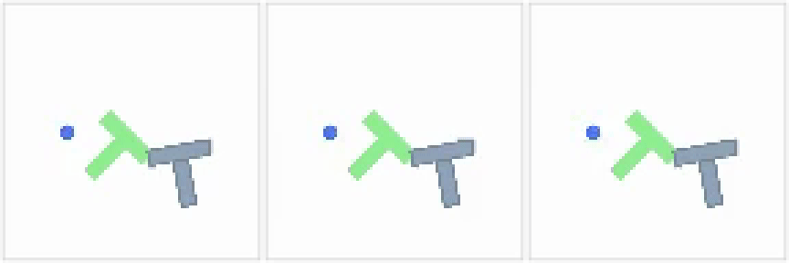
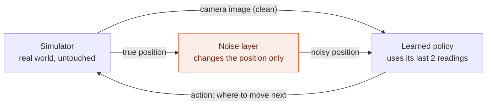
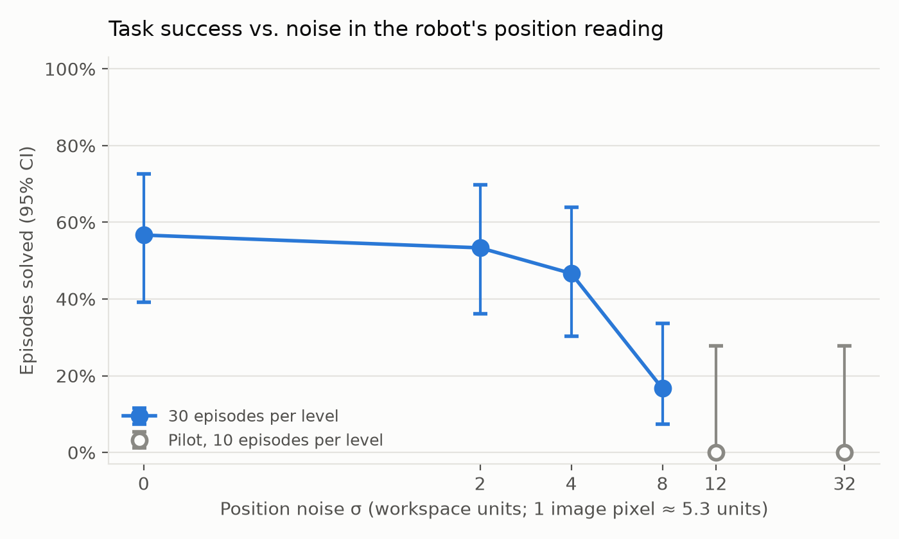

# How sensitive is a robot's learned controller to small errors in its position reading?

Robots that learn from human demonstrations rely on their sensors being accurate. This project takes an off-the-shelf, pretrained robot controller and tests, in simulation, what happens when the robot's reading of its *own position* is slightly wrong. The simulated world itself is never changed.



*The same starting situation, three times. Left: clean readings, task solved. Middle and right: the robot's position reading is perturbed by about 2 and 6 image pixels, and the task fails within the time limit.*
<!-- TODO(Selim): one sentence on what the robot visibly does in the noisy panels (twitching / drifting / hesitant). -->

## In one minute

- **The setup:** a simulated robot (the blue circle) must push a T-shaped block onto a target outline. It is controlled by a publicly available AI model that learned the task by imitating human demonstrations. It sees a camera image and its own position, and decides where to move next.
- **The experiment:** I add small random errors to the position the robot *reads*. The camera image and the real physics stay untouched. Every test uses the same 30 starting situations, so the only thing that changes is the error.
- **Finding 1:** errors smaller than one image pixel have no measurable effect. At about 1.5 pixels, the number of solved tasks drops from **17 out of 30 to 5 out of 30**.
- **Finding 2:** what hurts is that the error **changes at every step**, not its size. If an error of the same size is held **constant** for the whole attempt, the robot solves **16 out of 30**, as many as with clean readings.
- **Likely reason:** the controller looks at its last **two** position readings. When each reading is randomly off, the robot appears to move even when it is still, and that fake motion misleads it. A constant offset creates no fake motion. This explanation fits the data but is not proven.

## The setup at a glance



The loop runs every step. With **random noise**, a new error is drawn at every step, so a robot standing still produces readings that jump around, which looks like motion that doesn't exist. With a **constant offset**, the reading is wrong by the same amount each time, so it doesn't appear to move.

## Key terms

| Term | Meaning here |
|---|---|
| **Policy** | The learned controller: it maps what the robot observes to the next movement. |
| **Diffusion Policy** | The type of model used. It plans the next 16 moves at once, executes 8, then re-plans. |
| **PushT** | The simulated task: push a T-shaped block so it covers at least 95% of a target outline, within 300 steps. |
| **Noise level σ** | The typical size of the error added to the position reading, in the simulator's units. The workspace is 512 units wide, and the robot's camera image is 96 pixels wide, so **1 pixel ≈ 5.3 units**. |
| **Random noise vs. constant offset** | Random noise: a new, independent error at every step (white measurement noise). Constant offset: one random error drawn at the start and kept for the whole attempt (a bias). Both have the same typical size. |
| **Paired comparison** | Each condition is run on the same 30 starting situations, and the comparison is made situation by situation. |
| **95% CI / p-value** | The CI is the range the true success rate plausibly lies in, given only 30 attempts. A p-value below 0.05 means the difference is unlikely to be chance. |

## Results

### More noise, fewer solved tasks



| Noise level σ | ≈ pixels | Tasks solved | Different from clean? |
|---|---|---|---|
| 0 (clean) | 0 | 17 / 30 | — |
| 2 | 0.4 | 16 / 30 | no (p = 1.00) |
| 4 | 0.75 | 14 / 30 | no (p = 0.55) |
| **8** | **1.5** | **5 / 30** | **yes (p = 0.008)** |
| 12 *(pilot)* | 2.3 | 0 / 10 | yes (p = 0.016) |
| 32 *(pilot)* | 6 | 0 / 10 | yes (p = 0.016) |

*Pilot rows are a smaller, exploratory run on the first 10 starting situations.*

### Random noise vs. constant offset (same error size, σ = 8)

| Condition | Tasks solved |
|---|---|
| Clean | 17 / 30 |
| Constant offset | 16 / 30, not different from clean (p = 1.00) |
| Random noise | 5 / 30, clearly worse than the offset (p = 0.007) |

<details>
<summary>Full statistics</summary>

Success rates with 95% Wilson intervals, mean final target coverage (capped at 0.95, see the technical details), and the paired comparison against clean: "lost" = solved when clean but not under noise, "gained" = the reverse. p-values are from an exact McNemar test.

| σ | Solved | 95% CI | Lost / gained vs. clean | p | Mean coverage |
|---|---|---|---|---|---|
| 0 | 17/30 | 39–73% | — | — | 0.83 |
| 2 | 16/30 | 36–70% | 8 / 7 | 1.00 | 0.83 |
| 4 | 14/30 | 30–64% | 7 / 4 | 0.55 | 0.83 |
| 8 | 5/30 | 7–34% | 15 / 3 | 0.008 | 0.51 |
| 12 (pilot) | 0/10 | 0–28% | 7 / 0 | 0.016 | 0.28 |
| 32 (pilot) | 0/10 | 0–28% | 7 / 0 | 0.016 | 0.06 |

Offset (σ = 8) vs. clean: 4 situations solved only with the offset, 5 only when clean (p = 1.00). Offset vs. random noise: 13 solved only with the offset, 2 only with random noise (p = 0.007). Mean coverage with the offset: 0.84.

Across the four main comparisons, σ = 8 stays significant after a Bonferroni correction (0.008 < 0.05 / 4).

Raw data, one row per attempt: `results/main_paired.csv`, `results/pilot_paired.csv`, `results/ablation_offset.csv`. Summaries: `results/summary.csv`, `results/ablation_summary.csv`.
</details>

## How it works

1. **Load the pretrained controller** ([`lerobot/diffusion_pusht`](https://huggingface.co/lerobot/diffusion_pusht)) with Hugging Face's [LeRobot](https://github.com/huggingface/lerobot) library. Nothing is retrained.
2. **Insert a small "noise layer"** between the simulator and the controller. It changes only the position reading the controller receives.
3. **Check that the measurement tool itself is faithful.** With the noise set to zero, my evaluation reproduces LeRobot's official evaluation exactly, to the last decimal, on every attempt. Unit tests confirm that the noise never alters the real simulator state or the camera image.
4. **Run every condition on the same 30 starting situations** and compare them situation by situation.

<details>
<summary>Technical details</summary>

- **Model and task:** Diffusion Policy checkpoint at commit `84a7c23178445c6bbf7e1a884ff497017910f653`. Inputs: RGB image (3×96×96, 84×84 center crop) and 2D agent position, over the last 2 observations. Output: 2D target positions, predicted as a chunk of 16 actions, of which 8 are executed. [Gym-PushT](https://github.com/huggingface/gym-pusht) at 10 fps, 300-step limit, success = target coverage > 95%.
- **Checkpoint conversion:** the published checkpoint uses a file format older than LeRobot 0.7.0 (it predates PR #1452). `scripts/migrate_checkpoint.py` runs LeRobot's official migration script, plus a fix for two config fields (`crop_shape`, `down_dims`) stored as lists instead of tuples. All weight keys matched, and the normalization statistics and image preprocessing are unchanged.
- **Where the noise goes:** `src/perturbations.py` wraps the environment that LeRobot builds and perturbs the raw position (0–512 units) before any normalization, clipping to the workspace bounds. The noise has its own random generator, seeded per starting situation, separate from the generator the model uses for its own sampling.
- **Evaluation harness:** `src/evaluate.py` builds everything exactly as `lerobot-eval` does and calls LeRobot's own evaluation function. In paired mode, the global seed is reset before every attempt, so a given starting situation gets the same initial state, the same model sampling noise and the same observation noise in every condition.
- **Checks:** parity with `lerobot-eval` at σ = 0 (10/10 identical returns), 11 unit tests (`tests/`), and identical results across two independent runs on the 10 situations they share.
- **Coverage:** LeRobot does not pass gym-pusht's coverage value through. Gym-pusht defines `reward = clip(coverage / 0.95, 0, 1)`, so coverage is recovered exactly as `reward × 0.95` below the success threshold, and is capped at 0.95 for successful attempts.
- **Model randomness:** the controller is stochastic, so the same starting situation can succeed or fail depending on its internal sampling. The first 10 situations gave 8/10 with LeRobot's default seeding and 7/10 with per-attempt seeding. The paired design holds this randomness fixed across conditions.
</details>

## Limitations

- **One simulated toy task and one pretrained model.** The results say nothing directly about other models, other tasks, or physical robots.
- **Small samples.** 30 attempts per condition (10 in the pilot), so only fairly large effects are detectable, and the intervals are wide.
- **A simple error model, and a hypothesis.** The noise is Gaussian, on position only, with no lag or drift. The fake-motion explanation rests on a single comparison at one noise level.

## Reproduce

Tested on an Apple Silicon Mac (M4 Pro, macOS 15.6) using the GPU backend (MPS). The terminal must run natively: `uname -m` should print `arm64`.

```bash
# 1. Environment
conda create -n robot-bench python=3.12 -y
conda activate robot-bench
conda install -c conda-forge ffmpeg -y
pip install 'lerobot[evaluation,diffusion,pusht]==0.7.0' matplotlib pytest
# exact versions used: requirements-lock.txt

# 2. Convert the checkpoint (about 1 GB, git-ignored)
python scripts/migrate_checkpoint.py

# 3. Unit tests
pytest -q

# 4. Parity check: with no noise, results must match lerobot-eval exactly
COMMON="--policy.path=checkpoints/diffusion_pusht_migrated --env.type=pusht --eval.batch_size=1 \
  --policy.device=mps --policy.use_amp=false --seed=1000"
python src/evaluate.py --mode parity --sigmas 0 --csv results/parity_sigma0.csv \
  $COMMON --eval.n_episodes=10 --output_dir=outputs/parity_sigma0

# 5. Experiments
python src/evaluate.py --sigmas 0 2 4 8 --csv results/main_paired.csv \
  $COMMON --eval.n_episodes=30 --output_dir=outputs/main_paired
python src/evaluate.py --sigmas 0 12 32 --n-videos 2 --csv results/pilot_paired.csv \
  $COMMON --eval.n_episodes=10 --output_dir=outputs/pilot_paired
python src/evaluate.py --sigmas 8 --noise-type offset --csv results/ablation_offset.csv \
  $COMMON --eval.n_episodes=30 --output_dir=outputs/ablation_offset

# 6. Tables and plot
python src/analyze.py
```

`evaluate.py` appends to its CSV, so delete an existing file before regenerating it. Measured runtime: about 9–35 s per successful attempt depending on its length, and 34–36 s for an attempt that runs the full 300 steps. The main experiment (4 levels × 30 attempts) took about an hour.

<details>
<summary>Repository layout and versions</summary>

```text
scripts/migrate_checkpoint.py   checkpoint conversion to the LeRobot 0.7.0 format
src/perturbations.py            noise functions and the observation wrapper
src/evaluate.py                 evaluation harness (parity and paired modes), one CSV row per attempt
src/analyze.py                  confidence intervals, paired tests, determinism check, plot
tests/test_perturbations.py     unit tests, no simulator needed
results/                        raw per-attempt CSVs, summaries, plot
media/                          demo GIF
```

Python 3.12.16 · PyTorch 2.15.0 · LeRobot 0.7.0 · gym-pusht 0.1.8 · Gymnasium 1.4.0 · NumPy 2.2.6 · pandas 2.3.3 · Matplotlib 3.11.2 · ffmpeg 5.1 (conda-forge).

The `objc[...] Class ... is implemented in both ...` warnings are harmless: OpenCV, PyAV and pygame each bundle their own copies of FFmpeg and SDL. `results/parity_sigma0.csv` was produced before the coverage columns were added, and only its `success` and `sum_reward` columns are used.
</details>

## Acknowledgements

Built on [LeRobot](https://github.com/huggingface/lerobot), [Gym-PushT](https://github.com/huggingface/gym-pusht) and the pretrained checkpoint [`lerobot/diffusion_pusht`](https://huggingface.co/lerobot/diffusion_pusht). Diffusion Policy: Chi et al., *Diffusion Policy: Visuomotor Policy Learning via Action Diffusion*, RSS 2023.
